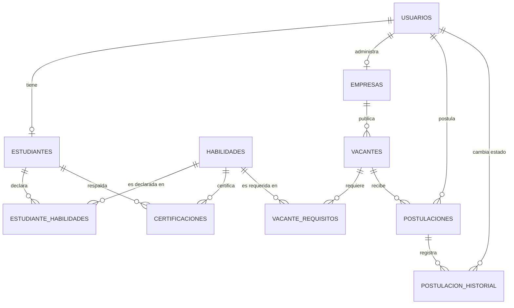

# Diseño de Base de Datos — TalentoMDD (PostgreSQL)

> Complementa [requirements.md](../requirements.md), [design.md](../design.md) y [tech.md](../tech.md). Script ejecutable en [schema.sql](schema.sql), datos de prueba/consultas en [seed_and_queries.sql](seed_and_queries.sql).
>
> **Cambio de motor:** la primera versión de este documento usaba MySQL. Los prompts del equipo piden **PostgreSQL** explícitamente (visión técnica general + instrucción directa del rol de Mijail: "Implementar PostgreSQL"), así que todo el diseño se reescribió en PostgreSQL 15+.
>
> **Cambio de nomenclatura:** `PERFILES`→`ESTUDIANTES`, `OFERTAS`→`VACANTES`, `PERFIL_HABILIDADES`→`ESTUDIANTE_HABILIDADES`, `OFERTA_HABILIDADES`→`VACANTE_REQUISITOS`, para alinear con el vocabulario que usa el equipo en sus propios prompts. Ver [requirements.md §2](../requirements.md).

## 1. Resumen del sistema

TalentoMDD conecta a estudiantes/egresados de la **UNAMAD** (Fase 1: solo Ingeniería de Sistemas y Administración) con empresas de **alcance nacional**, mediante perfiles por habilidades, microcertificaciones y un motor de matching. La base de datos debe soportar: cuentas de usuario, estudiantes con habilidades/nivel/disponibilidad/modalidad preferida, empresas (con verificación y bandera de convenio UNAMAD), vacantes con requisitos estructurados (habilidades, modalidad, jornada), postulaciones con una máquina de estados auditable, y el porcentaje de Match calculado por el backend.

## 2. Requerimientos identificados

De `requirements.md` (RF-1 a RF-5):

- Registro/login con contraseña protegida (hash, nunca texto plano).
- Estudiante: carrera (restringida a `sistemas`/`administracion` en Fase 1), ciclo, disponibilidad, modalidad preferida, habilidades con nivel, portafolio, CV.
- Empresa: perfil, ciudad (alcance nacional), bandera de convenio UNAMAD (RF-2.4), flujo de verificación (RF-4.2).
- Vacante: habilidades requeridas (obligatoria/deseable), modalidad, jornada — nunca texto libre.
- Postulación única (usuario, vacante), con matching calculado y máquina de estados auditable.
- Panel de administración: usuarios, verificación de empresas, moderación de vacantes, catálogo de habilidades, reportes básicos.

## 3. Entidades identificadas

`USUARIOS`, `ESTUDIANTES`, `EMPRESAS`, `HABILIDADES`, `ESTUDIANTE_HABILIDADES`, `VACANTES`, `VACANTE_REQUISITOS`, `CERTIFICACIONES`, `POSTULACIONES`, `POSTULACION_HISTORIAL`.

**Redundancia detectada y corregida (igual que en la versión anterior de este documento):** habilidades y requisitos como texto libre impiden el matching automático — se resolvió con el catálogo `HABILIDADES` + tablas puente.

**Contradicción detectada entre fuentes:** el documento maestro original modelaba empresas como locales de Madre de Dios con un modelo de precios fijos (S/20/S/40/S/70); los prompts del equipo especifican alcance nacional y un modelo freemium por fase de tracción. **Se sigue a los prompts del equipo por ser la fuente más reciente y explícita** — ver `requirements.md §1.2` y `§8`.

## 4. Diccionario de datos

### USUARIOS

| Campo | Tipo | PK | FK | NOT NULL | UNIQUE | DEFAULT | Descripción |
|---|---|---|---|---|---|---|---|
| id | INTEGER (IDENTITY) | ✔ | | ✔ | | auto | |
| nombre | VARCHAR(120) | | | ✔ | | | |
| correo | VARCHAR(150) | | | ✔ | ✔ | | |
| password_hash | VARCHAR(255) | | | ✔ | | | Hash Argon2id |
| foto_url | VARCHAR(255) | | | | | NULL | |
| tipo_usuario | tipo_usuario_enum | | | ✔ | | | `estudiante_egresado`/`empresa`/`administrador` |
| estado | estado_usuario_enum | | | ✔ | | `activo` | |
| fecha_creacion / fecha_actualizacion | TIMESTAMP | | | ✔ | | now() | Auditoría (trigger `set_updated_at`) |

### ESTUDIANTES

| Campo | Tipo | PK | FK | NOT NULL | UNIQUE | DEFAULT | Descripción |
|---|---|---|---|---|---|---|---|
| id | INTEGER (IDENTITY) | ✔ | | ✔ | | auto | |
| usuario_id | INTEGER | | ✔ → usuarios.id | ✔ | ✔ | | 1:1 |
| carrera | carrera_enum | | | | | NULL | `sistemas`/`administracion` (Fase 1) |
| ciclo | SMALLINT | | | | | NULL | CHECK 1–14 |
| disponibilidad | jornada_enum | | | | | NULL | Comparable con `vacantes.jornada` |
| modalidad_preferida | modalidad_enum | | | | | NULL | Comparable con `vacantes.modalidad` |
| experiencia / descripcion | TEXT | | | | | NULL | |
| portafolio_url | VARCHAR(255) | | | | | NULL | GitHub/portafolio |
| cv_url | VARCHAR(255) | | | | | NULL | |
| fecha_creacion / fecha_actualizacion | TIMESTAMP | | | ✔ | | now() | |

### EMPRESAS

| Campo | Tipo | PK | FK | NOT NULL | UNIQUE | DEFAULT | Descripción |
|---|---|---|---|---|---|---|---|
| id | INTEGER (IDENTITY) | ✔ | | ✔ | | auto | |
| usuario_id | INTEGER | | ✔ → usuarios.id | ✔ | ✔ | | 1:1 |
| nombre | VARCHAR(150) | | | ✔ | | | |
| descripcion | TEXT | | | | | NULL | |
| ciudad | VARCHAR(100) | | | | | NULL | Alcance nacional |
| convenio_unamad | BOOLEAN | | | ✔ | | FALSE | RF-2.4 |
| estado_verificacion | estado_verificacion_enum | | | ✔ | | `pendiente` | |
| fecha_creacion / fecha_actualizacion | TIMESTAMP | | | ✔ | | now() | |

### HABILIDADES

| Campo | Tipo | PK | FK | NOT NULL | UNIQUE | DEFAULT | Descripción |
|---|---|---|---|---|---|---|---|
| id | INTEGER (IDENTITY) | ✔ | | ✔ | | auto | |
| nombre | VARCHAR(100) | | | ✔ | ✔ | | |
| categoria | categoria_habilidad_enum | | | ✔ | | | |
| activo | BOOLEAN | | | ✔ | | TRUE | Soft-delete |

### ESTUDIANTE_HABILIDADES (N:M)

| Campo | Tipo | PK | FK | NOT NULL | Descripción |
|---|---|---|---|---|---|
| estudiante_id | INTEGER | ✔ | ✔ → estudiantes.id | ✔ | |
| habilidad_id | INTEGER | ✔ | ✔ → habilidades.id | ✔ | |
| nivel | SMALLINT | | | ✔ | CHECK 1–5 |

### VACANTES

| Campo | Tipo | PK | FK | NOT NULL | DEFAULT | Descripción |
|---|---|---|---|---|---|---|
| id | INTEGER (IDENTITY) | ✔ | | ✔ | auto | |
| empresa_id | INTEGER | | ✔ → empresas.id | ✔ | | |
| titulo | VARCHAR(150) | | | ✔ | | |
| descripcion | TEXT | | | ✔ | | |
| modalidad | modalidad_enum | | | ✔ | | `presencial`/`hibrido`/`remoto` |
| jornada | jornada_enum | | | ✔ | | `tiempo_completo`/`medio_tiempo`/`practicas` |
| ciudad | VARCHAR(100) | | | | NULL | NULL si es remoto |
| fecha_publicacion | DATE | | | ✔ | | |
| estado | estado_vacante_enum | | | ✔ | `activa` | |
| fecha_creacion / fecha_actualizacion | TIMESTAMP | | | ✔ | now() | |

### VACANTE_REQUISITOS (N:M)

| Campo | Tipo | PK | FK | NOT NULL | Descripción |
|---|---|---|---|---|---|
| vacante_id | INTEGER | ✔ | ✔ → vacantes.id | ✔ | |
| habilidad_id | INTEGER | ✔ | ✔ → habilidades.id | ✔ | |
| importancia | importancia_enum | | | ✔ | `obligatoria`/`deseable` |

### CERTIFICACIONES

| Campo | Tipo | PK | FK | NOT NULL | Descripción |
|---|---|---|---|---|---|
| id | INTEGER (IDENTITY) | ✔ | | ✔ | |
| estudiante_id | INTEGER | | ✔ → estudiantes.id | ✔ | |
| habilidad_id | INTEGER | | ✔ → habilidades.id | ✔ | |
| entidad_emisora | VARCHAR(150) | | | ✔ | |
| fecha_emision | DATE | | | ✔ | |
| evidencia_url | VARCHAR(255) | | | | NULL |
| fecha_creacion | TIMESTAMP | | | ✔ | Sin `fecha_actualizacion` (append-only) |

### POSTULACIONES

| Campo | Tipo | PK | FK | NOT NULL | UNIQUE | DEFAULT | Descripción |
|---|---|---|---|---|---|---|---|
| id | INTEGER (IDENTITY) | ✔ | | ✔ | | auto | |
| usuario_id | INTEGER | | ✔ → usuarios.id | ✔ | par | | |
| vacante_id | INTEGER | | ✔ → vacantes.id | ✔ | par | | |
| fecha_postulacion | TIMESTAMP | | | ✔ | | now() | |
| estado | estado_postulacion_enum | | | ✔ | | `postulado` | 7 valores |
| porcentaje_match | NUMERIC(5,2) | | | ✔ | | 0.00 | CHECK 0–100 |
| fecha_actualizacion | TIMESTAMP | | | ✔ | | now() | |

`UNIQUE(usuario_id, vacante_id)`: no se puede postular dos veces a la misma vacante.

### POSTULACION_HISTORIAL

| Campo | Tipo | PK | FK | NOT NULL | Descripción |
|---|---|---|---|---|---|
| id | INTEGER (IDENTITY) | ✔ | | ✔ | |
| postulacion_id | INTEGER | | ✔ → postulaciones.id | ✔ | |
| estado_anterior | estado_postulacion_enum | | | | NULL en el primer registro |
| estado_nuevo | estado_postulacion_enum | | | ✔ | |
| usuario_cambio_id | INTEGER | | ✔ → usuarios.id | | NULL | Quién ejecutó el cambio |
| fecha_cambio | TIMESTAMP | | | ✔ | now() |

## 5. Tablas — propósito y relación

| Tabla | Propósito | Se relaciona con |
|---|---|---|
| USUARIOS | Cuenta base (login único) | ESTUDIANTES, EMPRESAS, POSTULACIONES |
| ESTUDIANTES | Perfil técnico del estudiante UNAMAD | USUARIOS, ESTUDIANTE_HABILIDADES, CERTIFICACIONES |
| EMPRESAS | Empleador de cualquier región del Perú | USUARIOS, VACANTES |
| HABILIDADES | Catálogo controlado, habilita el matching | ESTUDIANTE_HABILIDADES, VACANTE_REQUISITOS, CERTIFICACIONES |
| ESTUDIANTE_HABILIDADES | Habilidades del estudiante con nivel | ESTUDIANTES, HABILIDADES |
| VACANTES | Publicaciones de empleo/prácticas | EMPRESAS, VACANTE_REQUISITOS, POSTULACIONES |
| VACANTE_REQUISITOS | Requisitos de la vacante con importancia | VACANTES, HABILIDADES |
| CERTIFICACIONES | Evidencia de una habilidad del estudiante | ESTUDIANTES, HABILIDADES |
| POSTULACIONES | Postulación estudiante→vacante con su Match | USUARIOS, VACANTES, POSTULACION_HISTORIAL |
| POSTULACION_HISTORIAL | Auditoría de cada cambio de estado | POSTULACIONES, USUARIOS |

No se creó una tabla `ROLES` genérica (se resolvió con `ENUM tipo_usuario`, solo 3 valores estables) siguiendo la misma lógica que en la versión anterior de este documento.

## 6. Relaciones

| Relación | Cardinalidad |
|---|---|
| USUARIO — ESTUDIANTE | 1:1 |
| USUARIO — EMPRESA | 1:1 |
| ESTUDIANTE — HABILIDAD | N:M (vía ESTUDIANTE_HABILIDADES) |
| VACANTE — HABILIDAD | N:M (vía VACANTE_REQUISITOS) |
| ESTUDIANTE — CERTIFICACION | 1:N |
| EMPRESA — VACANTE | 1:N |
| USUARIO — POSTULACION | 1:N |
| VACANTE — POSTULACION | 1:N |
| POSTULACION — POSTULACION_HISTORIAL | 1:N |

## 7. Reglas de negocio

| Regla | Dónde se controla |
|---|---|
| Un usuario tiene un rol válido | `ENUM tipo_usuario` |
| Correo único | `UNIQUE` |
| Contraseña nunca en texto plano | Hashing en el **backend** (Argon2id); la BD solo guarda el hash |
| No se puede postular dos veces a la misma vacante | `UNIQUE(usuario_id, vacante_id)` |
| Nivel de habilidad 1–5, match 0–100 | `CHECK` |
| Solo empresas verificadas publican vacantes | **Trigger** `trg_valida_empresa_verificada` |
| Una vacante debe tener ≥1 requisito | Función `crear_vacante_con_requisitos()` (atómica) |
| Los estados de postulación solo avanzan o terminan en rechazado/retirado | Función `cambiar_estado_postulacion()` |
| Cálculo del porcentaje de Match (fórmula 60/20/10/10) | **Backend** (`services/matching.py`, ver `design.md §6`), deliberadamente fuera de la BD — Antony debe poder iterar la fórmula sin migraciones |
| Solo estudiantes UNAMAD de Sistemas/Administración en Fase 1 | `ENUM carrera_enum` limita los valores posibles; la restricción de "solo UNAMAD" es de negocio/registro, no modelable como FK sin una tabla de instituciones — **Pendiente** si se abre a otras instituciones en Fase 2 |
| Aprobar/rechazar una empresa es una decisión humana | **Backend** (endpoint de administración) |

## 8. Normalización hasta 3FN

**1FN:** habilidades y requisitos como texto libre (documento original) violaban 1FN — se resolvió con `HABILIDADES` + tablas puente, igual que en la versión anterior de este documento.

**2FN:** en `ESTUDIANTE_HABILIDADES`, `nivel` depende de ambas partes de la clave compuesta (`estudiante_id`, `habilidad_id`) — cumple 2FN.

**3FN:** `VACANTES` no guarda `empresa_nombre` (dependería transitivamente de `empresa_id`); se obtiene por `JOIN` (`vw_vacantes_activas`). Igual razonamiento para `POSTULACIONES`.

**Desviación consciente:** `porcentaje_match` se almacena aunque es derivable — se fija como "foto" del momento de postular, porque no debe recalcularse solo si luego cambian las habilidades del estudiante o los requisitos de la vacante.

## 9. Índices

| Índice | Tabla | Campo(s) | Motivo |
|---|---|---|---|
| `usuarios_correo_key` | usuarios | correo | Login único y rápido (creado automáticamente por `UNIQUE`) |
| `idx_usuarios_tipo` | usuarios | tipo_usuario | Filtrar por rol en administración |
| `idx_empresas_estado` | empresas | estado_verificacion | Listar empresas pendientes (RF-4.2) |
| `idx_vacantes_estado_fecha` | vacantes | estado, fecha_publicacion | Listado de vacantes activas (RF-3.2) |
| `idx_vacantes_empresa` | vacantes | empresa_id | Vacantes de una empresa |
| `idx_vacantes_modalidad` | vacantes | modalidad | Filtro por modalidad (alcance nacional, remoto es clave) |
| `idx_post_vacante_match` | postulaciones | vacante_id, porcentaje_match DESC | Ranking de candidatos (RF-2.3/RF-5.2) |
| `idx_post_usuario` | postulaciones | usuario_id | Postulaciones de un estudiante |
| `idx_cert_estudiante` | certificaciones | estudiante_id | Certificaciones de un estudiante |
| `idx_hist_postulacion` | postulacion_historial | postulacion_id | Historial de una postulación |

## 10. Auditoría

| Tabla | Campos | Justificación |
|---|---|---|
| usuarios, estudiantes, empresas, vacantes, postulaciones | `fecha_creacion`, `fecha_actualizacion` (trigger `set_updated_at`) | Entidades mutables centrales |
| postulacion_historial | `fecha_cambio`, `usuario_cambio_id` | Es la propia tabla de auditoría |
| certificaciones | solo `fecha_creacion` | Append-only |
| habilidades, tablas puente | ninguno | Bajo cambio, no relevante como evento de negocio |

## 11. Seguridad

- `password_hash VARCHAR(255)`: Argon2id calculado en el backend antes del `INSERT` — nunca texto plano.
- Datos de prueba con `password_hash` de ejemplo, no credenciales reales.
- `cv_url`/`correo` deben filtrarse en el backend según la regla de visibilidad de `requirements.md §10` — la BD no impone visibilidad por fila en el MVP.
- JWT no se almacena en la base de datos (stateless).

## 12. Vistas

| Vista | Uso |
|---|---|
| `vw_vacantes_activas` | Listado público (solo `activa` + empresa `verificada`) |
| `vw_candidatos_por_vacante` | Candidatos de una vacante con su Match |
| `vw_estudiante_completo` | Perfil de un estudiante con habilidades agregadas (`STRING_AGG`) |

## 13. Funciones (procedimientos)

PostgreSQL moderno resuelve mejor este caso con **funciones PL/pgSQL** que con procedimientos `CALL` + `COMMIT`/`ROLLBACK` explícitos (que sí se usaban en la versión MySQL): una función se ejecuta dentro de la transacción del que la invoca, y un `RAISE EXCEPTION` no capturado revierte automáticamente todo lo que hizo, sin necesitar `ROLLBACK` manual.

| Función | Qué hace | Por qué existe |
|---|---|---|
| `cambiar_estado_postulacion(id, estado, actor)` | Valida la transición y actualiza `postulaciones` | Centraliza la regla de la máquina de estados (RF-3.4) |
| `crear_vacante_con_requisitos(...)` | Inserta la vacante y sus requisitos en una operación atómica | Garantiza que nunca exista una vacante sin al menos un requisito |
| `candidatos_por_vacante(vacante_id)` | Devuelve los candidatos ordenados por Match | Encapsula una consulta de reporte usada frecuentemente (RF-2.3) |

## 14. Triggers

| Trigger | Evento | Por qué es necesario |
|---|---|---|
| `trg_valida_empresa_verificada` | `BEFORE INSERT ON vacantes` | Bloquea a nivel de motor que una empresa no verificada publique |
| `trg_postulacion_historial` | `AFTER UPDATE ON postulaciones` | Garantiza que todo cambio de estado quede en el historial, sin importar qué ruta de código lo originó |
| `trg_*_updated_at` (5 tablas) | `BEFORE UPDATE` | Postgres no tiene `ON UPDATE CURRENT_TIMESTAMP` como columna; se resuelve con esta función reutilizable `set_updated_at()` |

## 15. Transacciones

**`cambiar_estado_postulacion`:** `SELECT ... FOR UPDATE` (bloquea la fila) → valida la transición → fija `talentomdd.actor_id` para el trigger → `UPDATE`. Si la transición no es válida, `RAISE EXCEPTION` aborta automáticamente toda la operación — no hace falta `ROLLBACK` explícito.

**`crear_vacante_con_requisitos`:** valida que haya al menos un requisito → `INSERT` en `vacantes` → `INSERT` masivo en `vacante_requisitos` (vía `jsonb_array_elements`). Si algo falla (p. ej. un `habilidad_id` inexistente viola la FK), Postgres revierte también la vacante recién creada dentro de la misma función.

## 16. Diagrama ER (Mermaid)

## 17. Script SQL completo

Ver [schema.sql](schema.sql) — ejecutable de principio a fin sobre una base de datos PostgreSQL vacía (15+, recomendado 16): tipos ENUM, 10 tablas en orden de dependencia, PK/FK con acciones justificadas, `CHECK`, 10 índices, 3 vistas, 3 triggers (+5 de auditoría), 3 funciones.

## 18. Datos de prueba

Ver [seed_and_queries.sql §A](seed_and_queries.sql) — contexto realista: 5 estudiantes UNAMAD (Sistemas/Administración, con ciclo/disponibilidad/modalidad preferida variados), 3 empresas de alcance nacional (Lima, Puerto Maldonado —intencionalmente `pendiente`—, Arequipa con convenio UNAMAD), 14 habilidades, 3 vacantes (una réplica exacta del ejemplo ilustrativo del equipo: SQL+Git+JavaScript+React), 5 postulaciones con porcentajes de Match calculados a mano con la fórmula 60/20/10/10 (incluye casos donde la disponibilidad/modalidad bajan el score aunque la cobertura de habilidades sea alta), y 3 certificaciones.

## 19. Consultas de prueba

Ver [seed_and_queries.sql §B](seed_and_queries.sql): básicas, relacionadas (`JOIN`), estadísticas, y de negocio — incluye una consulta nueva de "empresas por ciudad" para verificar la distribución geográfica ahora que el alcance es nacional.

## 20. Pruebas de integridad

Ver [seed_and_queries.sql §C](seed_and_queries.sql) — 11 casos con **qué se prueba → qué debería suceder → cómo verificarlo**, incluyendo el nuevo caso C.10 (vacante sin requisitos, antes probado indirectamente, ahora explícito porque la validación vive en la función, no en un `CHECK` de tabla).

> **Nota de verificación:** este entorno no tiene PostgreSQL ni Docker instalados, así que no pude ejecutar el script contra un motor real. Lo revisé exhaustivamente (tipos de retorno de las funciones, orden de columnas en cada `INSERT`, consistencia de los IDs generados por `crear_vacante_con_requisitos()` con las referencias posteriores, y recalculé a mano cada `porcentaje_match` del seed contra la fórmula de `design.md §6.1`), pero eso no sustituye una ejecución real. Mijail debería correrlo primero (tarea 2.22 de [tasks.md](../tasks.md)); si algo falla, el mensaje de error exacto permite corregirlo de inmediato.

## 21. Cómo conectar la base de datos con el backend

- **ORM:** SQLAlchemy 2.x (dialecto `postgresql`, driver `psycopg`) mapea cada tabla; Alembic versiona los cambios a partir de este script.
- **Tipos ENUM de Postgres:** SQLAlchemy los mapea con `sqlalchemy.Enum` — declarar los mismos valores que en `schema.sql` para que Alembic no intente recrear los tipos.
- **Funciones:** el backend puede invocar `cambiar_estado_postulacion()` y `crear_vacante_con_requisitos()` directamente con `SELECT` (vía `session.execute(text("SELECT cambiar_estado_postulacion(:id, :estado, :actor)"), ...)`), para no duplicar la regla de negocio en Python y SQL a la vez.
- **Qué tabla usa cada tipo de operación:**

| Tabla | GET | POST | PUT/PATCH | DELETE |
|---|---|---|---|---|
| usuarios | login, perfil propio | registro | editar perfil | desactivar (soft, `estado`) |
| estudiantes | ver perfil | se crea junto al usuario | editar carrera/ciclo/disponibilidad/habilidades/CV/portafolio | — |
| empresas | listar, ver una | registro | verificar (admin) | — |
| habilidades | listar catálogo | admin agrega | admin desactiva (`activo=false`) | — |
| vacantes | buscar/listar | publicar (`crear_vacante_con_requisitos`) | cerrar/ocultar | — |
| postulaciones | ver propias/recibidas | postular | cambiar estado (`cambiar_estado_postulacion`) | — |
| postulacion_historial | ver historial | (automático, vía trigger) | — | — |

- **Qué debe devolver la API:** nunca el modelo crudo de `usuarios` (expondría `password_hash`).

## 22. Posibles mejoras futuras

- Recalcular `porcentaje_match` si el perfil o la vacante cambian después de postular (hoy queda fijo).
- Migrar `HABILIDADES` a incluir un `esco_uri` opcional, para interoperar con la taxonomía ESCO sin comprometerse desde el MVP.
- Cuando el proyecto abra a otras universidades (Fase 2, `requirements.md §9`), introducir una tabla `INSTITUCIONES` y mover `estudiantes.carrera` a una FK contra un catálogo de carreras propio de cada institución, en vez del `ENUM` cerrado actual.
- Índice `FULLTEXT`/`tsvector` sobre `vacantes.descripcion` si la búsqueda libre se vuelve relevante — hoy el MVP busca por habilidad/carrera/modalidad.
- Particionar `postulacion_historial` si crece mucho (no es un problema al volumen académico del MVP).
