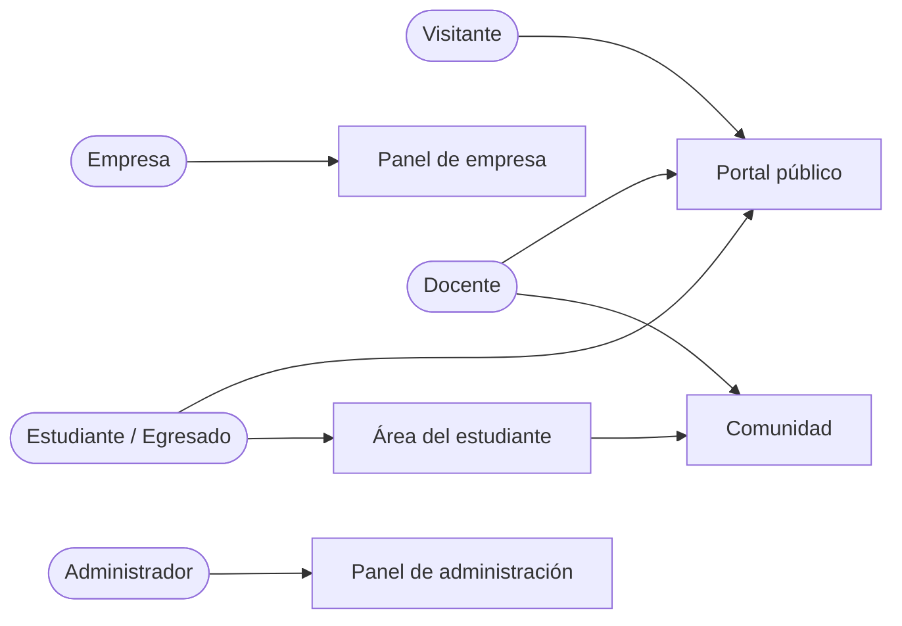
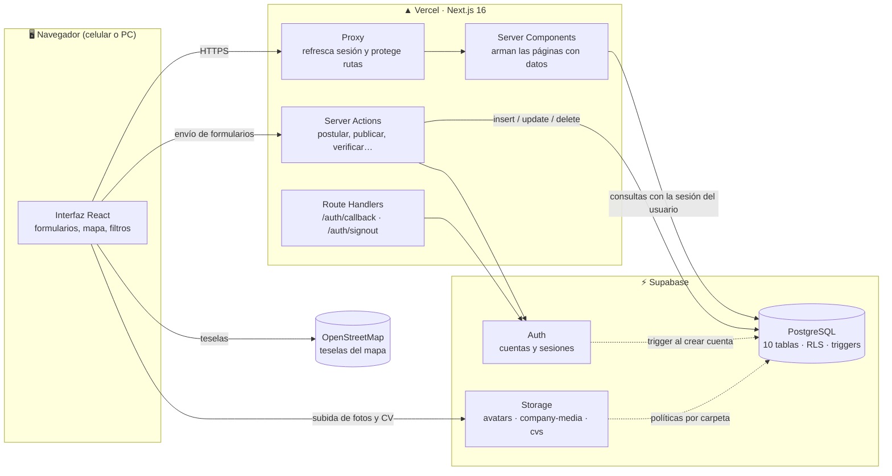
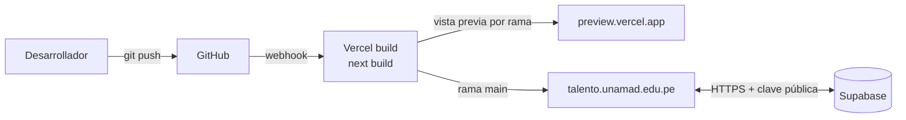
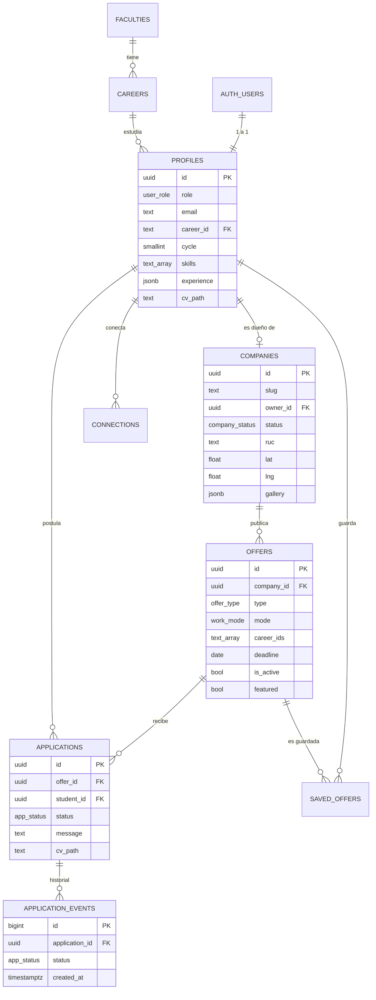
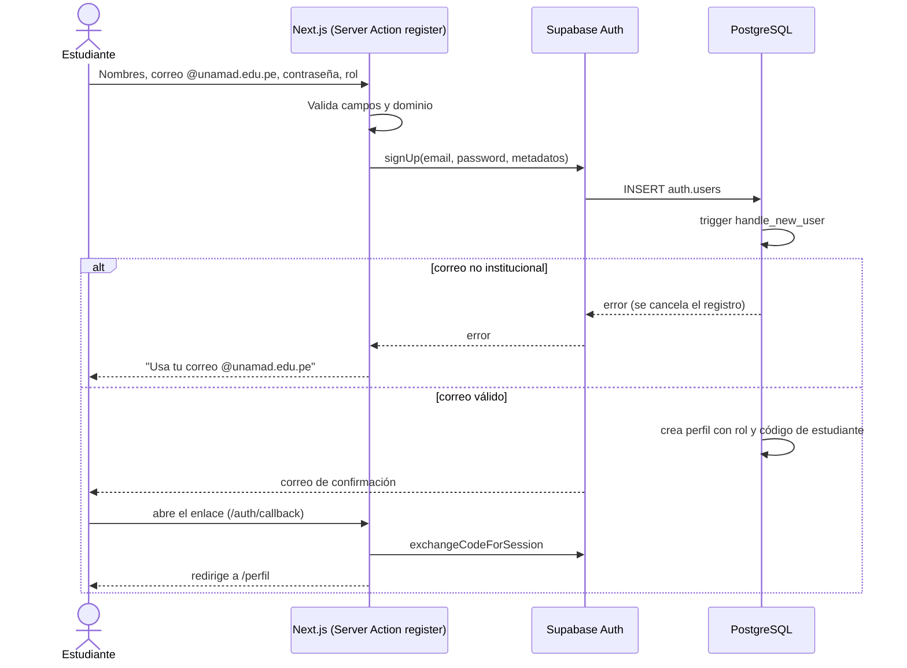
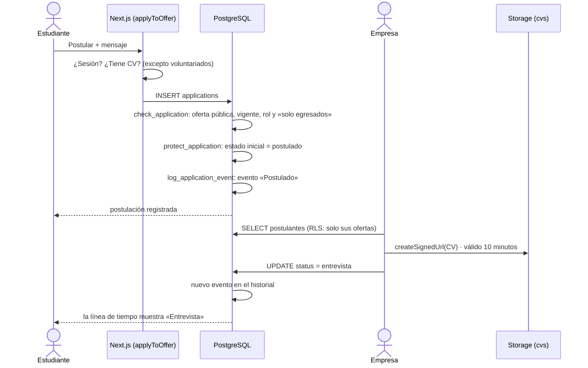
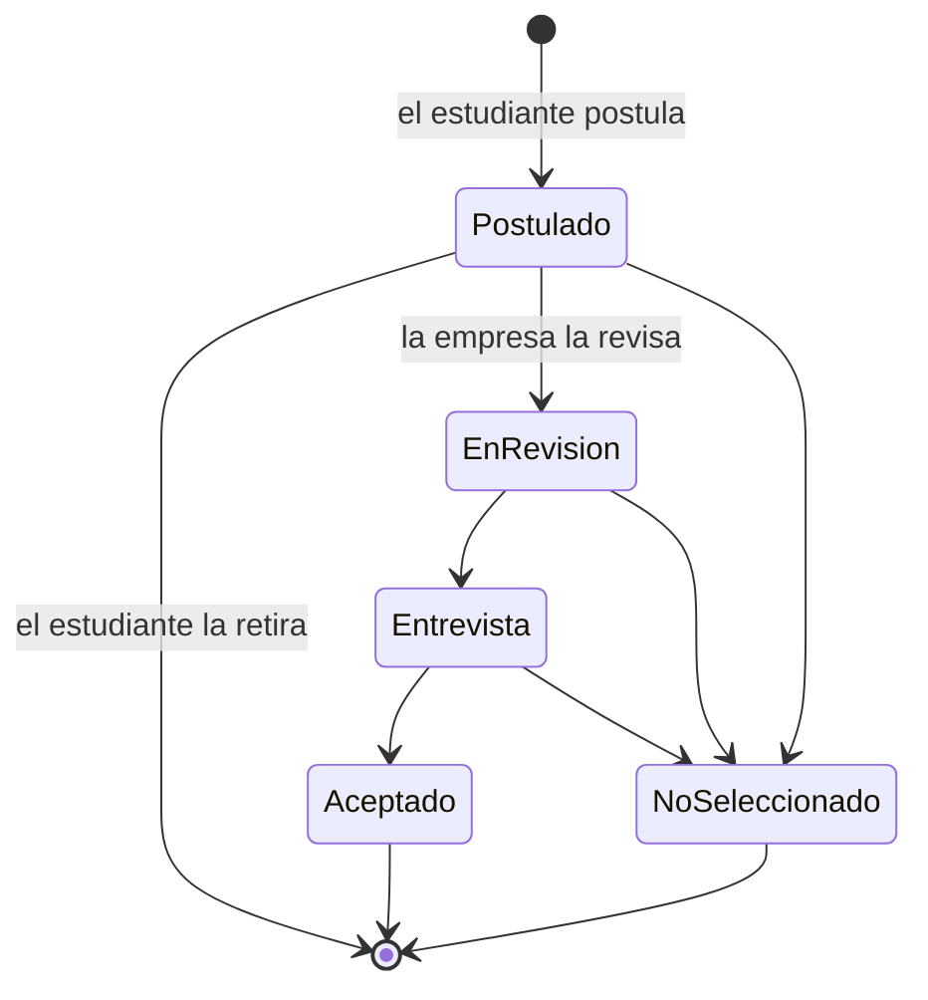
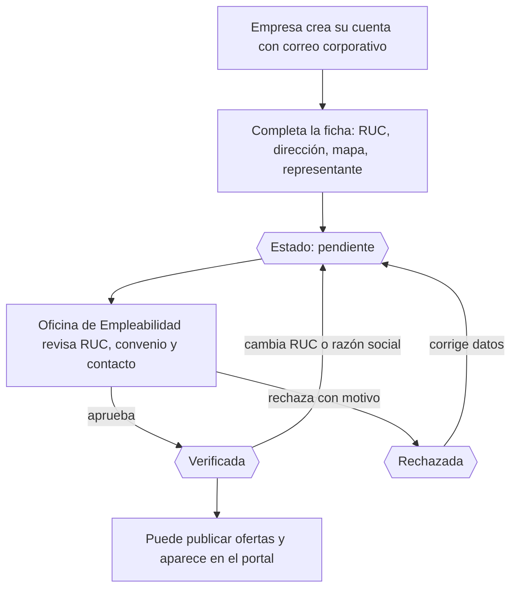
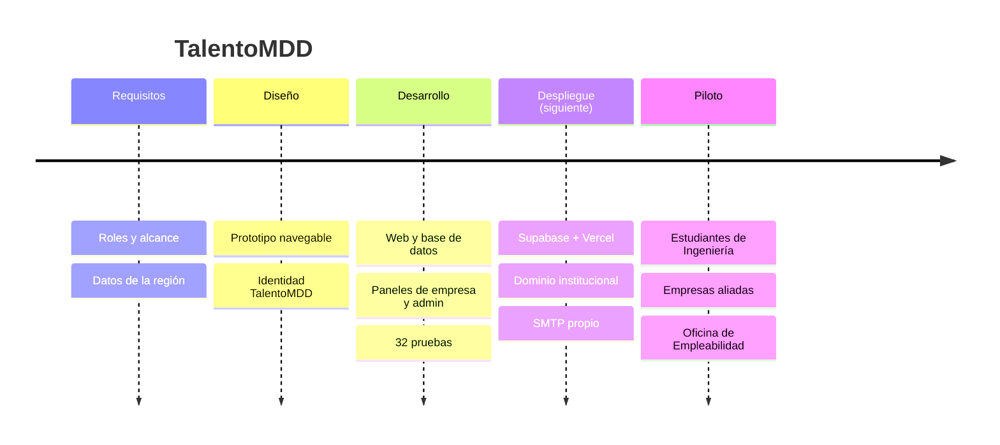

# TalentoMDD · Arquitectura, tecnologías e integración

> **Portal de empleabilidad de la Universidad Nacional Amazónica de Madre de Dios (UNAMAD)**
> Documento técnico para la expo de proyectos · Octubre de 2026

| | |
|---|---|
| **Proyecto** | TalentoMDD |
| **Tipo de sistema** | Aplicación web institucional (portal de empleabilidad) |
| **Institución** | UNAMAD · Oficina de Empleabilidad y Seguimiento al Egresado |
| **Usuarios** | Estudiantes, egresados, docentes, empresas y administradores |
| **Framework principal** | Next.js 16 (React 19, TypeScript) |
| **Backend como servicio** | Supabase (PostgreSQL, Auth, Storage) |
| **Hosting** | Vercel |
| **Estado** | Desarrollo completo y probado · siguiente etapa: despliegue |

---

## Índice

1. [Resumen](#1-resumen)
2. [Problema y solución](#2-problema-y-solución)
3. [Actores y permisos](#3-actores-y-permisos)
4. [Stack tecnológico](#4-stack-tecnológico)
5. [Arquitectura general](#5-arquitectura-general)
6. [Cómo se integra cada pieza](#6-cómo-se-integra-cada-pieza)
7. [Mapa de pantallas](#7-mapa-de-pantallas)
8. [Modelo de datos](#8-modelo-de-datos)
9. [Flujos principales](#9-flujos-principales)
10. [Seguridad](#10-seguridad)
11. [Calidad y pruebas](#11-calidad-y-pruebas)
12. [Despliegue y costos](#12-despliegue-y-costos)
13. [Estructura del repositorio](#13-estructura-del-repositorio)
14. [Estado del proyecto y hoja de ruta](#14-estado-del-proyecto-y-hoja-de-ruta)
15. [Guion para la expo](#15-guion-para-la-expo)
16. [Preguntas probables del jurado](#16-preguntas-probables-del-jurado)
17. [Glosario](#17-glosario)

---

## 1. Resumen

TalentoMDD conecta a estudiantes y egresados de la UNAMAD con empresas **verificadas por la universidad** que ofrecen prácticas pre-profesionales, prácticas profesionales, empleos y voluntariados.

El sistema está construido con **tres piezas**:

| Pieza | Rol en el sistema |
|---|---|
| **Next.js** (en Vercel) | Construye las páginas, recibe los formularios y protege las rutas privadas. |
| **Supabase** | Guarda los datos (PostgreSQL), gestiona las cuentas (Auth) y los archivos (Storage). |
| **Vercel** | Publica el sitio en internet y lo actualiza automáticamente desde GitHub. |

**Idea central de la arquitectura:** la seguridad vive **dentro de la base de datos** (Row Level Security y triggers). Aunque alguien manipule la página, PostgreSQL no le entrega datos que no le corresponden.

### Cifras del sistema

| Indicador | Valor |
|---|---|
| Rutas (páginas y endpoints) | 28 |
| Server Actions (operaciones del servidor) | 29 |
| Tablas en la base de datos | 10 |
| Políticas de seguridad (RLS + Storage) | 52 |
| Triggers de validación y auditoría | 11 |
| Buckets de archivos | 3 |
| Pruebas automáticas de seguridad y datos | 32 |
| Datos de ejemplo | 11 empresas · 16 ofertas · 1 facultad · 3 carreras |

---

## 2. Problema y solución

### Problema

- Las ofertas de prácticas llegan por canales dispersos (murales, WhatsApp, correos sueltos).
- El estudiante no sabe si una empresa es confiable, dónde queda ni a quién contactar.
- La universidad no tiene un registro de cuántos estudiantes postulan, a qué empresas ni con qué resultado.
- Las empresas no tienen un canal directo para encontrar talento de carreras específicas.

### Solución

| Necesidad | Cómo la resuelve TalentoMDD |
|---|---|
| Ofertas centralizadas | Catálogo con filtros por carrera, facultad, tipo, modalidad y pago, más vista de mapa. |
| Confianza | Solo publican empresas **verificadas** por la Oficina de Empleabilidad (RUC, convenio, datos de contacto). |
| Información completa | Ficha de empresa con galería, ubicación en mapa, teléfono, correo y representante. |
| Seguimiento | Cada postulación tiene una línea de tiempo: postulado → en revisión → entrevista → aceptado / no seleccionado. |
| Datos para la universidad | Panel de administración con métricas de estudiantes, empresas, ofertas y postulaciones. |
| Acceso exclusivo | Registro solo con correo institucional `@unamad.edu.pe` (empresas con correo corporativo). |

---

## 3. Actores y permisos



| Acción | Visitante | Estudiante | Egresado | Docente | Empresa | Admin |
|---|:-:|:-:|:-:|:-:|:-:|:-:|
| Ver ofertas y empresas verificadas | ✅ | ✅ | ✅ | ✅ | ✅ | ✅ |
| Crear perfil con foto, portada y CV | — | ✅ | ✅ | ✅ (sin CV) | — | — |
| Postular a ofertas | — | ✅ | ✅ | — | — | — |
| Postular a ofertas «solo egresados» | — | — | ✅ | — | — | — |
| Guardar ofertas | — | ✅ | ✅ | — | — | — |
| Directorio de la comunidad y conexiones | — | ✅ | ✅ | ✅ | — | ✅ |
| Registrar su empresa (queda «en revisión») | — | — | — | — | ✅ | — |
| Publicar, editar, pausar y eliminar ofertas | — | — | — | — | ✅ (si está verificada) | ✅ |
| Ver postulantes y su CV | — | — | — | — | ✅ (solo los suyos) | ✅ |
| Cambiar el estado de una postulación | — | — | — | — | ✅ (solo las suyas) | ✅ |
| Verificar, rechazar o suspender empresas | — | — | — | — | — | ✅ |
| Destacar u ocultar ofertas | — | — | — | — | — | ✅ |
| Cambiar roles, publicar novedades, gestionar carreras | — | — | — | — | — | ✅ |

---

## 4. Stack tecnológico

### 4.1 Tecnologías y versiones

| Capa | Tecnología | Versión | Para qué la usamos |
|---|---|---|---|
| Framework web | **Next.js** (App Router) | 16.4 | Páginas, enrutamiento, renderizado en el servidor, Server Actions y Proxy. |
| Librería de interfaz | **React** | 19.3 | Componentes de la interfaz y formularios interactivos. |
| Lenguaje | **TypeScript** | 5 | Tipado estático en todo el código: detecta errores antes de ejecutar. |
| Estilos | **Tailwind CSS** | 4 | Diseño con los colores y tipografías de la marca definidos como tokens. |
| Íconos | **Lucide** | 1.6 | Íconos SVG ligeros y consistentes. |
| Base de datos | **PostgreSQL** (en Supabase) | 15+ | Datos relacionales, triggers, funciones y reglas RLS. |
| Autenticación | **Supabase Auth** | — | Registro, inicio de sesión, confirmación de correo, recuperación de contraseña y Google opcional. |
| Archivos | **Supabase Storage** | — | Fotos de perfil, logos, galerías y CVs. |
| Conexión con Supabase | `@supabase/ssr` + `@supabase/supabase-js` | 0.12 · 2.118 | Sesión en cookies, compatible con el renderizado en el servidor. |
| Mapas | **Leaflet** + **OpenStreetMap** | 1.9 | Mapa de ofertas, ubicación de empresas y selector de ubicación. Sin costo de licencia. |
| Tipografías | Bricolage Grotesque, Hanken Grotesk, Instrument Serif | — | Identidad visual de TalentoMDD (Google Fonts, servidas por Next.js). |
| Hosting | **Vercel** | — | Publicación, HTTPS, CDN y despliegue automático desde GitHub. |
| Calidad | ESLint · `tsc` · PGlite | — | Lint, verificación de tipos y pruebas de la base de datos. |

### 4.2 Por qué elegimos cada tecnología

| Decisión | Alternativas consideradas | Por qué esta |
|---|---|---|
| **Next.js** | React puro (Vite), Laravel, Django | Un solo proyecto para la interfaz y la lógica del servidor. Renderiza en el servidor (más rápido y mejor para buscadores). Es el estándar de la industria con React. |
| **Supabase** | Firebase, un backend propio con Node/Express, MySQL en un VPS | Es PostgreSQL estándar (no nos ata a un proveedor), trae login y archivos integrados y permite **seguridad por filas** (RLS). Plan gratuito para desarrollar. |
| **Vercel** | Hosting compartido, VPS propio | Creado por los autores de Next.js: despliegue en un clic, HTTPS automático y cero mantenimiento de servidores. |
| **TypeScript** | JavaScript | Evita errores comunes (campos mal escritos, datos nulos) en un proyecto con muchas pantallas y roles. |
| **Tailwind CSS** | CSS tradicional, Bootstrap | Diseño propio y fiel al prototipo; los colores de la marca están centralizados en un solo lugar. |
| **Leaflet + OpenStreetMap** | Google Maps | Sin tarjeta de crédito ni cobro por uso; buena cobertura de Puerto Maldonado. |

---

## 5. Arquitectura general

### 5.1 Vista de componentes



### 5.2 Principios de diseño

1. **Servidor primero.** Las páginas se construyen en el servidor (Server Components): el navegador recibe HTML listo y no maneja datos sensibles.
2. **Sin API intermedia.** Los formularios llaman directamente a funciones del servidor (Server Actions). No hay que mantener una API REST aparte.
3. **Seguridad en la base de datos.** Las reglas de acceso son políticas RLS en PostgreSQL. La web usa solo la **clave pública** de Supabase; nunca la clave de servicio.
4. **Reglas de negocio con triggers.** Validaciones que no se pueden saltar (correo institucional, oferta vigente, estados válidos) viven en PostgreSQL.
5. **Configuración por variables de entorno.** Marca, universidad y dominio institucional se cambian sin tocar el código.

---

## 6. Cómo se integra cada pieza

### 6.1 Next.js: la capa web

| Mecanismo | Dónde está | Qué hace en TalentoMDD |
|---|---|---|
| **App Router** | `src/app/` | Cada carpeta es una ruta. Grupos: públicas, `(auth)`, `perfil`, `postulaciones`, `comunidad`, `empresa`, `admin`. |
| **Server Components** | `page.tsx` de cada ruta | Leen la sesión y consultan Supabase en el servidor antes de enviar la página. |
| **Client Components** | `src/components/*` con `"use client"` | Partes interactivas: filtros en vivo, mapa, subida de archivos, ventana de postulación, animaciones. |
| **Server Actions** | `src/app/actions/*.ts` | 29 operaciones: autenticación, perfil, postulación, empresa, administración y archivos. |
| **Proxy** | `src/proxy.ts` | Antes de cada petición renueva la sesión de Supabase y redirige al login si la ruta es privada. |
| **Route Handlers** | `src/app/auth/*` | `/auth/callback` recibe los enlaces de confirmación, recuperación y Google; `/auth/signout` cierra la sesión. |

**Server Actions por módulo:**

| Módulo | Operaciones |
|---|---|
| `auth.ts` | `login`, `register`, `requestPasswordReset`, `updatePassword` |
| `student.ts` | `applyToOffer`, `withdrawApplication`, `toggleSave`, `toggleConnection`, `updateProfile` |
| `media.ts` | `setProfileImage`, `setCv`, `getCvUrl`, `setCompanyImage`, `setCompanyGallery` |
| `company.ts` | `saveCompany`, `saveOffer`, `toggleOfferActive`, `deleteOffer`, `setApplicationStatus` |
| `admin.ts` | `setCompanyStatus`, `updateCompanyStats`, `deleteCompany`, `setOfferFlag`, `setUserRole`, `createNews`, `deleteNews`, `createFaculty`, `createCareer`, `deleteCareer` |

### 6.2 Supabase: datos, cuentas y archivos

| Servicio | Integración |
|---|---|
| **Auth** | `signUp` guarda nombre, apellidos y rol en los metadatos. Al insertarse el usuario, el trigger `handle_new_user` crea su perfil y **rechaza** correos que no sean `@unamad.edu.pe` (salvo el rol empresa). La sesión viaja en cookies seguras (`@supabase/ssr`). |
| **PostgreSQL** | 10 tablas, funciones `security definer` reutilizables (`is_admin`, `owns_company`, `is_my_applicant`…) y 11 triggers. |
| **RLS** | Cada tabla tiene políticas que filtran filas según `auth.uid()` y el rol. La misma consulta devuelve datos distintos a un estudiante, a una empresa o al admin. |
| **Storage** | 3 buckets. La ruta del archivo empieza con el ID del dueño (`{usuario}/cv-….pdf`) y las políticas la comparan con la sesión. |
| **RPC** | `portal_stats()` (contadores de la portada), `community_directory()` y `public_profile()` (solo datos no sensibles). |

### 6.3 Vercel: publicación



### 6.4 Leaflet + OpenStreetMap

- **Listado de ofertas (vista mapa):** un marcador por empresa con ofertas presenciales o híbridas.
- **Ficha de empresa:** mapa con su ubicación y botón «Cómo llegar» (Google Maps).
- **Registro de empresa:** la empresa hace clic en el mapa (o usa su GPS) para guardar latitud y longitud.
- Se carga solo en el navegador, con importación dinámica, para no afectar el renderizado en el servidor.

---

## 7. Mapa de pantallas

| Ruta | Acceso | Descripción |
|---|---|---|
| `/` | Público | Portada: buscador, contadores animados, ofertas destacadas, carreras, carrusel de empresas, cómo funciona, testimonios, FAQ. |
| `/ofertas` | Público | Listado con filtros (texto, facultad, carrera, tipo, modalidad, pago, orden) y vista de lista o mapa. |
| `/ofertas/[id]` | Público | Ficha completa: requisitos, condiciones, proceso de selección, datos de la empresa, mapa y ofertas similares. |
| `/empresas` | Público | Empresas verificadas, filtrables por rubro. |
| `/empresas/[slug]` | Público | Perfil de la empresa: galería, contacto, representante, estadísticas y ofertas activas. |
| `/login` · `/registro` | Público | Inicio de sesión y registro con selector de rol y validación del dominio en vivo. |
| `/recuperar` · `/actualizar-clave` | Público / sesión | Recuperación de contraseña por correo. |
| `/perfil` | Estudiante, egresado, docente | Perfil con fortaleza (%), CV y resumen de postulaciones. |
| `/perfil/editar` | Estudiante, egresado, docente | Foto, portada, CV en PDF, datos académicos, experiencia, proyectos, certificaciones, idiomas. |
| `/postulaciones` | Estudiante, egresado | Postulaciones con línea de tiempo y ofertas guardadas. |
| `/comunidad` · `/comunidad/[id]` | Comunidad universitaria | Directorio por carrera, conexiones, perfiles públicos y novedades. |
| `/empresa` | Empresa | Registro de empresa o panel con métricas y tabla de ofertas. |
| `/empresa/perfil` | Empresa | Datos, ubicación en mapa, logo, portada, galería y representante. |
| `/empresa/ofertas/nueva` · `/[id]` | Empresa verificada | Crear o editar una oferta. |
| `/empresa/ofertas/[id]/postulantes` | Empresa | Postulantes, CV, mensaje, historial y cambio de estado. |
| `/admin` | Administrador | Métricas y empresas por verificar. |
| `/admin/empresas` · `/ofertas` · `/usuarios` · `/contenido` | Administrador | Gestión de empresas, ofertas, roles, novedades, facultades y carreras. |
| `/auth/callback` · `/auth/signout` | Sistema | Confirmación de enlaces y cierre de sesión. |

---

## 8. Modelo de datos

### 8.1 Diagrama entidad-relación



### 8.2 Tablas

| Grupo | Tabla | Contenido |
|---|---|---|
| Catálogo | `faculties`, `careers` | Facultades y carreras con su ícono. Editables desde el panel de administración. |
| Personas | `profiles` | Rol, datos académicos, contacto, habilidades, experiencia, proyectos, certificaciones, idiomas, foto, portada y CV. |
| Personas | `connections` | Conexiones entre miembros de la comunidad. |
| Empresas | `companies` | Datos legales (RUC, razón social), rubro, ubicación, contacto, representante, galería y estado de verificación. |
| Empresas | `offers` | Tipo, modalidad, carreras, ciclo mínimo, pago, vacantes, fecha límite, funciones, requisitos, beneficios y etapas. |
| Empresas | `saved_offers` | Ofertas guardadas por cada estudiante. |
| Proceso | `applications` | Postulación (estudiante + oferta), mensaje, CV usado y estado actual. Única por estudiante y oferta. |
| Proceso | `application_events` | Historial automático de cada cambio de estado. |
| Contenido | `news` | Novedades de la universidad. |

### 8.3 Tipos enumerados

| Tipo | Valores |
|---|---|
| `user_role` | estudiante · egresado · docente · empresa · admin |
| `offer_type` | pre (pre-profesional) · pro (profesional) · emp (empleo) · vol (voluntariado) |
| `work_mode` | Presencial · Remoto · Híbrido |
| `app_status` | postulado · revision · entrevista · aceptado · rechazado |
| `company_status` | pendiente · verificada · rechazada |

---

## 9. Flujos principales

### 9.1 Registro con correo institucional



### 9.2 Postulación a una oferta



### 9.3 Ciclo de vida de una postulación



### 9.4 Verificación de una empresa



---

## 10. Seguridad

### 10.1 Capas de protección

| Capa | Medida |
|---|---|
| Transporte | HTTPS en Vercel y Supabase. |
| Sesión | Cookies gestionadas por `@supabase/ssr`; el Proxy valida el token (`getClaims`) en cada petición. |
| Rutas | Las rutas privadas redirigen al login; cada página comprueba además el rol (`requireRole`). |
| Formularios | Validación en el servidor, mensajes por campo y envío siempre por POST (los datos nunca viajan en la URL). |
| Base de datos | 52 políticas RLS y de Storage, más 11 triggers. |
| Archivos | CVs en un bucket privado; solo los ve su dueño, la empresa a la que postuló o el admin, mediante un enlace firmado que vence en 10 minutos. |
| Claves | La web usa solo la clave pública; la clave de servicio nunca se usa ni se sube a Vercel. |
| Datos personales | Consentimiento explícito en el registro y tratamiento conforme a la Ley N.º 29733. |

### 10.2 Reglas que garantiza la base de datos

| Regla | Mecanismo |
|---|---|
| Solo correos `@unamad.edu.pe` para estudiantes, egresados y docentes | Trigger `handle_new_user` |
| Nadie puede asignarse el rol de administrador ni cambiar su correo | Trigger `protect_profile` |
| Una empresa nace «pendiente» y no puede verificarse a sí misma | Trigger `protect_company` |
| Si una empresa cambia su RUC o razón social, vuelve a revisión | Trigger `protect_company` |
| Solo el admin destaca ofertas en la portada | Trigger `protect_offer` |
| Las empresas no verificadas no pueden publicar | Política RLS de `offers` |
| Las ofertas pausadas o de empresas no verificadas no son públicas | Función `offer_is_public` |
| No se puede postular a convocatorias cerradas, ni dos veces, ni sin el rol correcto | Trigger `check_application` + restricción única |
| El estudiante no puede cambiar el estado de su postulación | Trigger `protect_application` |
| Una empresa solo ve perfiles de quienes postularon a sus ofertas | Política RLS + `is_my_applicant` |
| El directorio de la comunidad no muestra teléfono, correo ni código | Función `community_directory` |
| Cada cambio de estado queda registrado | Trigger `log_application_event` |

---

## 11. Calidad y pruebas

| Tipo | Herramienta | Resultado |
|---|---|---|
| Pruebas de base de datos y seguridad | `npm run db:verify` (PGlite: PostgreSQL en memoria) | **32/32** correctas |
| Verificación de tipos | `npm run typecheck` (TypeScript) | 0 errores |
| Calidad de código | `npm run lint` (ESLint + reglas de React) | 0 errores |
| Compilación de producción | `npm run build` (Next.js) | 28 rutas compiladas |
| Prueba de punta a punta | Navegador + Supabase local (Docker) | Flujo completo correcto |

**Qué cubren las 32 pruebas:** registro con y sin correo institucional; visibilidad de datos por rol; intento de autoasignarse administrador; empresa que intenta autoverificarse o crear una segunda empresa; publicación sin verificación; estado inicial de la postulación; postulación duplicada, cerrada o «solo egresados»; acceso de una empresa a perfiles ajenos; historial de estados; subida y lectura de CVs en carpetas ajenas; ofertas pausadas; contadores públicos.

**Flujo probado en el navegador:** registro de estudiante → edición de perfil (fortaleza del 0 % al 63 %) → subida de CV → postulación → registro de empresa con validaciones → verificación por el administrador → publicación de oferta → revisión del postulante, apertura del CV y cambio de estado a «Entrevista».

**Errores encontrados y corregidos gracias a las pruebas:**
1. Una política RLS con una columna ambigua impedía al estudiante ver ofertas cerradas a las que ya había postulado.
2. Si un formulario se enviaba antes de que cargara la página, los datos (incluida la contraseña) podían viajar en la URL. Se corrigió forzando el envío por POST.

---

## 12. Despliegue y costos

### 12.1 Pasos de despliegue

1. **Supabase:** crear el proyecto (región São Paulo), ejecutar la migración `supabase/migrations/…_init.sql` y el seed.
2. **Auth:** configurar la *Site URL* y las *Redirect URLs*, la contraseña mínima de 8 caracteres y un **SMTP propio** para los correos.
3. **Administrador:** registrarse y ejecutar `update public.profiles set role = 'admin' where email = '…';`.
4. **Vercel:** importar el repositorio desde GitHub y definir las variables de entorno.
5. **Dominio:** pedir a la OTI el subdominio (por ejemplo `talento.unamad.edu.pe`) y su registro DNS.

### 12.2 Variables de entorno

| Variable | Ejemplo | Uso |
|---|---|---|
| `NEXT_PUBLIC_SUPABASE_URL` | `https://xxxx.supabase.co` | Dirección del proyecto Supabase |
| `NEXT_PUBLIC_SUPABASE_PUBLISHABLE_KEY` | `sb_publishable_…` | Clave pública (la seguridad está en RLS) |
| `NEXT_PUBLIC_SITE_URL` | `https://talento.unamad.edu.pe` | Enlaces de los correos de confirmación |
| `NEXT_PUBLIC_INSTITUTIONAL_DOMAIN` | `unamad.edu.pe` | Dominio aceptado en el registro |
| `NEXT_PUBLIC_ENABLE_GOOGLE` | `true` / `false` | Botón «Continuar con Google» |

### 12.3 Costos estimados

Precios aproximados a la fecha; deben confirmarse en el sitio de cada proveedor antes de contratar.

| Etapa | Supabase | Vercel | Dominio | Total mensual aprox. |
|---|---|---|---|---|
| Desarrollo y pruebas | Gratis | Gratis | Subdominio de la UNAMAD | **US$ 0** |
| Piloto / producción | Pro ≈ US$ 25 | Pro ≈ US$ 20 | Subdominio de la UNAMAD | **≈ US$ 45** |

> Vercel Hobby (gratis) es solo para uso no comercial; para un sitio institucional en producción conviene el plan Pro.

---

## 13. Estructura del repositorio

```
talentomdd/
├── supabase/
│   ├── migrations/20261029000000_init.sql   # Tablas, tipos, funciones, triggers, RLS y buckets
│   ├── seed.sql                             # Facultad, carreras, 11 empresas, 16 ofertas, novedades
│   └── config.toml                          # Supabase local (Docker)
├── scripts/
│   └── verify-db.mjs                        # 32 pruebas de base de datos y seguridad
├── src/
│   ├── proxy.ts                             # Sesión y protección de rutas
│   ├── lib/
│   │   ├── supabase/                        # Clientes de Supabase (servidor y navegador)
│   │   ├── auth.ts                          # Sesión, roles y redirecciones
│   │   ├── data.ts                          # Consultas reutilizables
│   │   ├── types.ts · constants.ts · format.ts
│   ├── app/
│   │   ├── actions/                         # 29 Server Actions en 5 módulos
│   │   ├── (auth)/                          # Login, registro, recuperación
│   │   ├── ofertas/ · empresas/             # Portal público
│   │   ├── perfil/ · postulaciones/ · comunidad/
│   │   ├── empresa/                         # Panel de empresa
│   │   └── admin/                           # Panel de administración
│   └── components/                          # Tarjetas, mapa, formularios, subida de archivos, UI
├── .env.example                             # Variables de entorno de referencia
└── README.md                                # Guía de instalación y despliegue
```

---

## 14. Estado del proyecto y hoja de ruta



| Etapa | Estado |
|---|---|
| Requisitos y alcance | ✅ Completado |
| Diseño UX/UI y prototipo | ✅ Completado |
| Desarrollo (frontend, backend, base de datos, paneles) | ✅ Completado |
| Pruebas (automáticas y de punta a punta) | ✅ Completado |
| Despliegue en Supabase y Vercel | ⏳ Siguiente |
| Piloto con usuarios reales | ⬜ Pendiente |

**Mejoras futuras propuestas:**
- Notificaciones por correo cuando cambia el estado de una postulación.
- Mensajería entre estudiantes y empresas (hoy marcada como «próximamente»).
- Reportes descargables (Excel/PDF) para la Oficina de Empleabilidad.
- Incorporar las demás facultades de la UNAMAD (Educación, Ecoturismo, etc.) desde el panel de administración.
- Recomendación de ofertas según la carrera y las habilidades del perfil.

---

## 15. Guion para la expo

Duración sugerida: **10 minutos** de exposición + 5 de preguntas.

| Min. | Bloque | Contenido | Apoyo |
|---|---|---|---|
| 0–1 | Apertura | Problema: ofertas dispersas, empresas sin verificar, sin seguimiento. | Sección 2 |
| 1–2 | Solución | Qué es TalentoMDD y quiénes lo usan. | Sección 3 |
| 2–4 | Stack | Next.js, Supabase y Vercel, y por qué los elegimos. | Sección 4 |
| 4–5 | Arquitectura | Diagrama de componentes y principios de diseño. | Sección 5 |
| 5–8 | **Demo en vivo** | Ver guion abajo. | Navegador |
| 8–9 | Seguridad y calidad | RLS, triggers, 32 pruebas. | Secciones 10 y 11 |
| 9–10 | Cierre | Estado actual, despliegue y mejoras futuras. | Sección 14 |

### Guion de la demo (3 minutos)

1. **Portada** (`/`): mostrar el buscador, los contadores y las ofertas destacadas.
2. **Ofertas** (`/ofertas`): filtrar por «Ingeniería de Sistemas» y cambiar a la vista de mapa.
3. **Registro** (`/registro`): escribir un correo `@gmail.com` → se marca en rojo; cambiar a `@unamad.edu.pe`.
4. **Postular:** abrir una oferta, pulsar «Postular», enviar el mensaje y mostrar la línea de tiempo en «Mis postulaciones».
5. **Empresa:** entrar con la cuenta de empresa, abrir los postulantes, ver el CV y cambiar el estado a «Entrevista».
6. **Volver al estudiante:** la línea de tiempo ya muestra «Entrevista».

> Consejo: tener las tres cuentas (estudiante, empresa y administrador) abiertas en ventanas distintas para no perder tiempo iniciando sesión.

---

## 16. Preguntas probables del jurado

**¿Por qué no hicieron un backend propio con Node o PHP?**
Supabase ya ofrece PostgreSQL, autenticación y archivos con seguridad por filas. Nos permitió concentrarnos en las reglas del negocio en vez de reconstruir un login y un servidor de archivos. Además es PostgreSQL estándar: si la universidad lo pide, la base se migra a sus servidores sin reescribir el sistema.

**¿Qué pasa si alguien manipula la página o llama directamente a la base de datos?**
Las reglas de acceso están en PostgreSQL (RLS y triggers), no solo en la interfaz. Lo comprobamos con pruebas automáticas: un estudiante no puede ver postulaciones ajenas ni hacerse administrador, y una empresa no puede verificarse a sí misma.

**¿Cómo se asegura que solo entren estudiantes de la UNAMAD?**
Un trigger en la base de datos rechaza el registro si el correo no es `@unamad.edu.pe`. Se valida también en el formulario y en el servidor. Opcionalmente se puede activar «Continuar con Google» restringido al dominio de la universidad.

**¿Quién ve el CV del estudiante?**
Solo el estudiante, las empresas a cuyas ofertas postuló y el administrador. El archivo está en un bucket privado y se abre con un enlace firmado que vence en 10 minutos.

**¿Cuánto cuesta mantenerlo?**
Nada durante el desarrollo. En producción, unos US$ 45 al mes (Supabase Pro + Vercel Pro), sin servidores que mantener.

**¿Soporta muchos usuarios?**
Sí, para la escala de la UNAMAD. Vercel distribuye el sitio por CDN y Supabase escala la base de datos sin cambios en el código.

**¿Funciona en celular?**
Sí. El diseño es responsive y se probó en una pantalla de 375 px de ancho sin desbordes.

**¿Cómo se agregan otras facultades?**
Desde el panel de administración, sección «Novedades y carreras», sin tocar el código.

---

## 17. Glosario

| Término | Significado |
|---|---|
| **App Router** | Sistema de rutas de Next.js basado en carpetas. |
| **Server Component** | Componente de React que se ejecuta en el servidor y envía HTML listo al navegador. |
| **Server Action** | Función del servidor que se llama directamente desde un formulario, sin API intermedia. |
| **Proxy** | Código de Next.js que se ejecuta antes de cada petición (antes llamado *middleware*). |
| **Supabase** | Plataforma que ofrece PostgreSQL, autenticación y almacenamiento de archivos como servicio. |
| **RLS (Row Level Security)** | Reglas de PostgreSQL que deciden, fila por fila, qué datos puede leer o modificar cada usuario. |
| **Trigger** | Función de la base de datos que se ejecuta automáticamente al insertar o actualizar datos. |
| **Bucket** | Contenedor de archivos en Supabase Storage. |
| **URL firmada** | Enlace temporal que da acceso a un archivo privado durante un tiempo limitado. |
| **Migración** | Archivo SQL que crea o modifica la estructura de la base de datos de forma reproducible. |
| **Seed** | Datos de ejemplo que se cargan para probar el sistema. |
| **CDN** | Red de servidores que entrega el sitio desde el punto más cercano al usuario. |
| **Responsive** | Diseño que se adapta a celular, tableta y computadora. |

---

*TalentoMDD · UNAMAD · Documento técnico para la expo de proyectos.*
